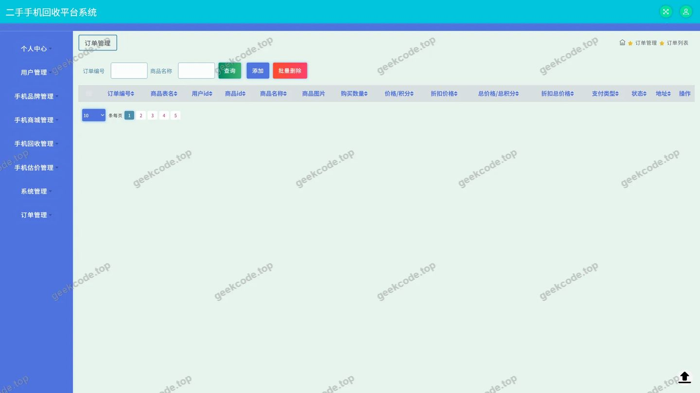
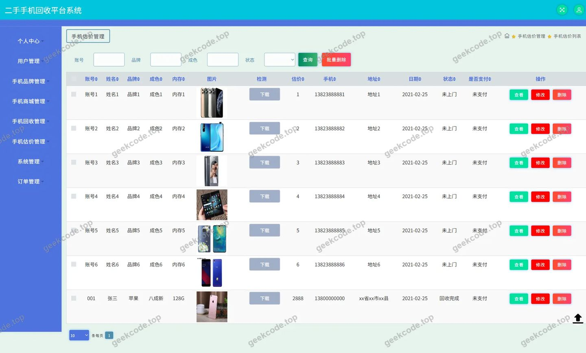
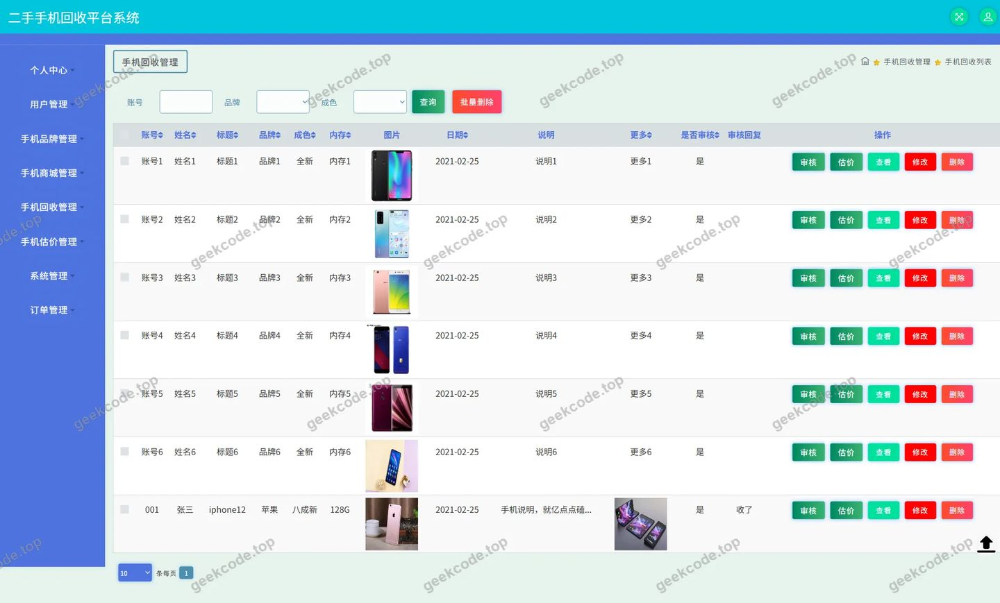
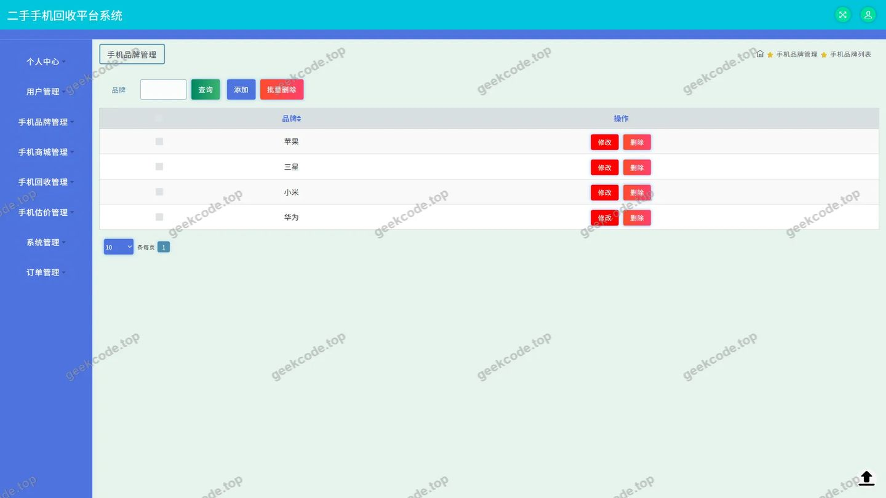
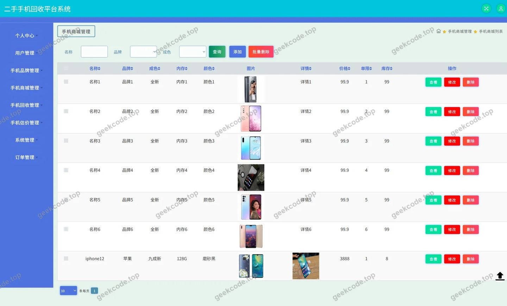
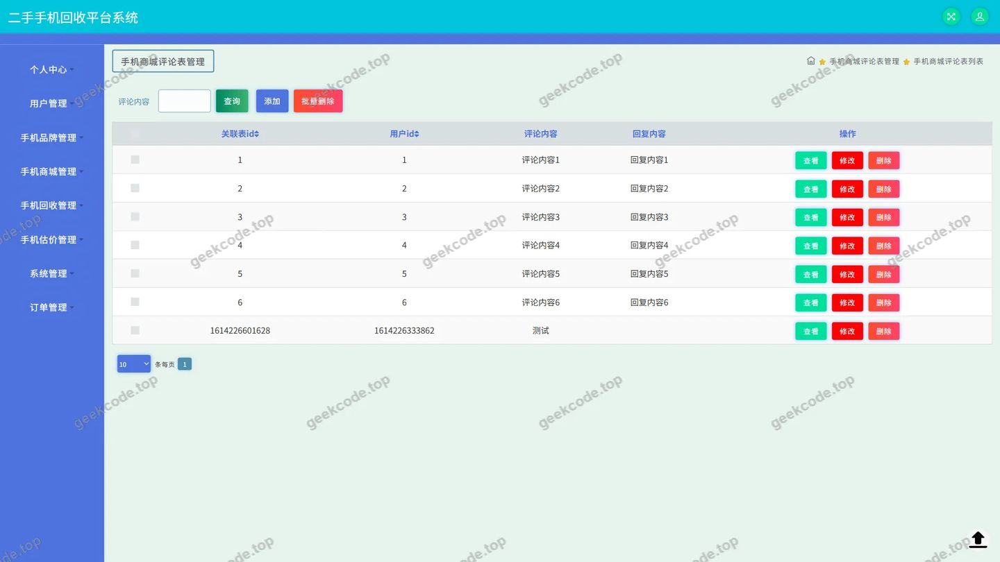
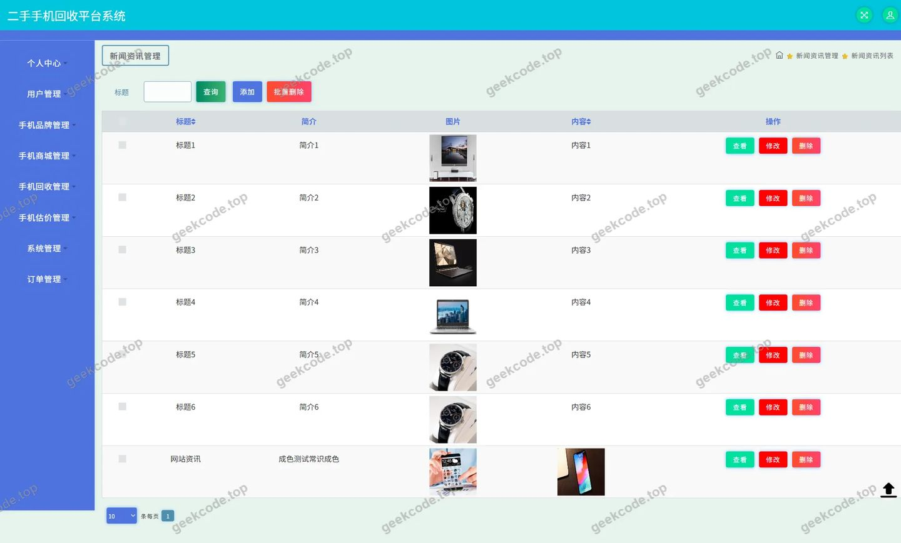
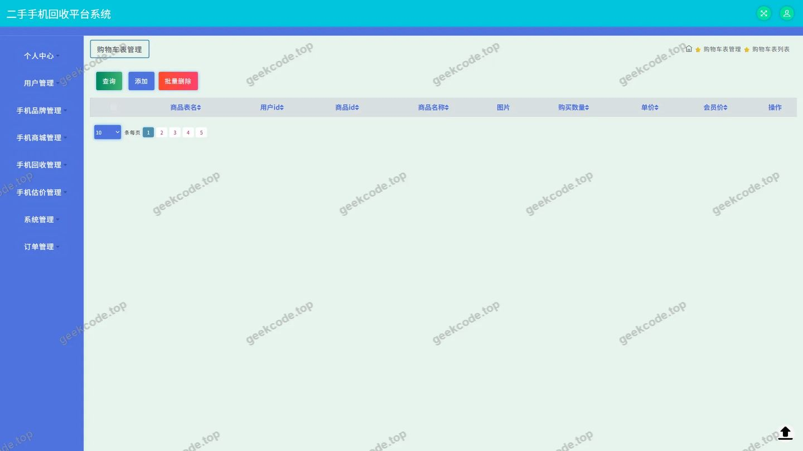

# 二手手机回收平台系统

> 🎓 **计算机毕业设计 · 二手手机回收平台系统**
>
> 本仓库只放**项目介绍 + 运行截图**（截图是站点带水印的原图，存在仓库 `images/` 里）。
>
> 👉 **完整可运行源码 / 数据库脚本 / 部署文档：[点我获取](https://geekcode.top/archives/%E4%BA%8C%E6%89%8B%E6%89%8B%E6%9C%BA%E5%9B%9E%E6%94%B6%E5%B9%B3%E5%8F%B0%E7%B3%BB%E7%BB%9F?utm_source=github)**
>
> 💬 咨询微信：**ir9372**　|　🌐 更多项目：[极客代码 geekcode.top](https://geekcode.top/?utm_source=github)
>
> 📌 项目详情页：<https://geekcode.top/archives/%E4%BA%8C%E6%89%8B%E6%89%8B%E6%9C%BA%E5%9B%9E%E6%94%B6%E5%B9%B3%E5%8F%B0%E7%B3%BB%E7%BB%9F?utm_source=github>

<table><td width="230" align="center"> <b>扫码加微信 ir9372</b></td><td valign="middle">📦 源码 = 项目介绍 + 全部运行截图 + 数据库 + 部署文档 👉 点上方任意截图，直接跳到 <b>极客代码 geekcode.top</b> 详情页</td></table>

---

<h1>二手手机回收平台系统</h1>
<h2>项目概述</h2>

本项目为“二手手机回收平台系统”，旨在构建一个基于 Java Web 技术的纯 API 后端服务，支撑二手手机交易、估价与回收业务。系统核心功能涵盖手机商城展示、新闻资讯发布、用户个人中心管理（含订单、地址、收藏）、手机品牌维护及在线估价回收流程。适用人群主要为有二手手机买卖需求的普通用户及平台运营人员。技术架构采用 Spring Boot 框架结合 MyBatis-Plus 进行数据持久化操作，使用 Druid 作为数据库连接池，确保高并发下的稳定性。虽然前端界面未在代码中直接体现，但通过提供的导航菜单可知，系统支持前台用户浏览商城、阅读资讯及管理个人资产，实现了从信息展示到交易闭环的基础服务能力。

<h2>技术架构</h2>

本系统采用典型的 B/S 架构中的后端服务模式，具体技术选型与设计如下：

<ol>
<li><strong>核心框架</strong>：基于 Spring Boot 快速构建应用，利用其自动配置特性简化开发流程。核心依赖包括 <code>spring-core</code>、<code>spring-context</code>、<code>spring-web</code> 和 <code>spring-webmvc</code>，负责 IoC 容器管理、Web 请求处理及 RESTful API 接口暴露。</li>
<li><strong>数据访问层</strong>：集成 <code>MyBatis-Plus</code> 作为 ORM 框架，提供高效的 CRUD 操作及分页插件支持；底层数据库驱动配合 <code>spring-jdbc</code> 实现 SQL 执行。</li>
<li><strong>连接池管理</strong>：选用 <code>Druid</code> 作为数据库连接池，具备强大的监控功能和防御 SQL 注入的能力，保障数据库连接的复用效率与安全。</li>
<li><strong>事务与安全</strong>：引入 <code>spring-tx</code> 管理声明式事务，确保订单创建、库存扣减等关键业务的数据一致性；<code>spring-aop</code> 用于切面编程，辅助日志记录或权限校验。</li>
<li><strong>模块设计</strong>：控制器层（Controller）按业务领域划分，如 <code>ShoujishangchengController</code> 处理商品逻辑，<code>OrdersController</code> 处理订单流转，<code>AddressController</code> 管理收货地址，体现了高内聚低耦合的设计原则。</li>
</ol>
<h2>功能模块</h2>

根据 Controller 列表及导航菜单，系统主要功能模块划分为以下部分：

<h3>前台用户端功能</h3>
<ul>
<li><strong>手机商城模块</strong>：由 <code>ShoujishangchengController</code> 支撑，提供二手手机的浏览、详情查看及购买入口。包含评论互动功能，通过 <code>DiscussshoujishangchengController</code> 实现用户对商品的讨论与评价。</li>
<li><strong>新闻资讯模块</strong>：由 <code>NewsController</code> 提供，展示平台发布的行业资讯、公告等内容，增强用户粘性。</li>
<li><strong>手机估价与回收模块</strong>：</li>
<li><strong>手机估价</strong>：<code>ShoujigujiaController</code> 负责接收用户输入的手机参数，返回预估价格。</li>
<li><strong>手机回收</strong>：<code>ShoujihuishouController</code> 处理回收申请流程，关联估价结果生成回收订单。</li>
<li><strong>手机品牌</strong>：<code>ShoujipinpaiController</code> 维护品牌基础数据，供估价和商城筛选使用。</li>
<li><strong>个人中心模块</strong>：</li>
<li><strong>我的订单</strong>：<code>OrdersController</code> 查询和管理用户的购买及回收订单状态。</li>
<li><strong>我的地址</strong>：<code>AddressController</code> 增删改查用户的收货地址信息。</li>
<li><strong>我的收藏</strong>：通常由通用接口或特定业务接口支持，允许用户标记感兴趣的商品。</li>
<li><strong>购物车</strong>：<code>CartController</code> 管理待结算的商品集合。</li>
<li><strong>基础服务</strong>：</li>
<li><strong>登录认证</strong>：通过 <code>CommonController</code> 或专用接口处理用户身份验证。</li>
<li><strong>文件上传</strong>：<code>FileController</code> 处理头像、商品图片等非结构化数据的存储。</li>
<li><strong>系统配置</strong>：<code>ConfigController</code> 提供前端所需的动态配置参数。</li>
</ul>
<h3>后台管理端功能</h3>

根据现有上下文信息，该项目标记为 &quot;pure-api&quot; 且无明确的前台路由或后台路由定义，同时截图仅展示了用户侧页面。因此，<strong>根据现有信息无法确定</strong>是否存在独立的后台管理界面及其具体功能模块。上述 Controller 主要服务于前端 API 调用需求。

<h2>用户角色与权限</h2>

基于系统提供的 Controller 和业务场景，主要涉及以下角色及其权限范围：

<table>
<thead>
<tr>
<th align="left">角色</th>
<th align="left">可访问功能模块</th>
<th align="left">权限描述</th>
</tr>
</thead>
<tbody><tr>
<td align="left"><strong>普通用户</strong></td>
<td align="left">手机商城、新闻资讯、个人中心</td>
<td align="left">1. <strong>浏览与交互</strong>：查看手机商品列表、详情页、新闻文章。2. <strong>交易相关</strong>：加入购物车、提交订单、发起手机估价、申请手机回收。3. <strong>个人管理</strong>：修改个人资料、管理收货地址、查看历史订单、管理收藏夹。4. <strong>社区参与</strong>：对手机商品发表评论或回复。</td>
</tr>
<tr>
<td align="left"><strong>游客/未登录用户</strong></td>
<td align="left">手机商城、新闻资讯</td>
<td align="left">1. <strong>只读访问</strong>：浏览公开的手机商品信息、新闻内容。2. <strong>限制操作</strong>：无法下单、无法估价、无法评论、无法进入个人中心。需登录后方可解锁完整功能。</td>
</tr>
</tbody></table>

<em>注：由于缺乏明确的 RBAC（基于角色的访问控制）代码片段或管理员 Controller，系统中是否包含“超级管理员”角色及其具体的后台数据维护权限（如审核评论、上架商品、管理品牌），根据现有信息无法确定。</em>

<h2>项目特色与创新点</h2>
<ol>
<li><strong>垂直领域精细化服务</strong>：区别于综合电商平台，本项目专注于“二手手机”这一细分品类，提供了从“估价”到“回收”再到“销售”的全生命周期服务链路，解决了二手交易中定价不透明和信任缺失的核心痛点。</li>
<li><strong>API 优先架构设计</strong>：采用 Pure-API 模式，前后端分离彻底。所有业务逻辑封装在 Controller 层并通过 JSON 交互，便于未来扩展移动端 App、小程序或多端适配，具备良好的可维护性和跨平台能力。</li>
<li><strong>数据驱动的估价模型</strong>：通过 <code>ShoujigujiaController</code> 与 <code>ShoujipinpaiController</code> 的联动，构建了基于品牌和型号的结构化估价体系，为用户提供相对客观的市场参考依据，提升了交易的公平性。</li>
<li><strong>完善的用户资产管理</strong>：集成了地址、订单、收藏、购物车四大核心用户资产模块，形成了完整的电商闭环体验，不仅限于简单的信息展示，更强调了交易过程的便捷性与安全性。</li>
</ol>
<h2>部署环境</h2>

为确保系统正常运行，服务器环境需满足以下要求：

<ol>
<li><strong>操作系统</strong>：Linux (CentOS 7+/Ubuntu 20.04+) 或 Windows Server 2016+。</li>
<li><strong>Java 运行环境</strong>：JDK 1.8 或 JDK 11（Spring Boot 标准兼容版本）。</li>
<li><strong>数据库</strong>：MySQL 5.7 或 MySQL 8.0，需安装并启动服务，创建对应的业务数据库。</li>
<li><strong>构建工具</strong>：Maven 3.6+，用于依赖管理和项目打包。</li>
<li><strong>Web 服务器</strong>：内置 Tomcat（由 Spring Boot 自动嵌入），无需额外独立安装 Nginx 或 Apache，但若需域名解析和高可用，建议前置 Nginx 反向代理。</li>
<li><strong>其他依赖</strong>：若涉及文件上传存储，需配置本地磁盘路径或对接对象存储服务（OSS/COS）；需确保防火墙开放应用端口（默认通常为 8080）。</li>
</ol>
<h2>五、技术特性</h2>
<ul>
<li>使用 MyBatis-Plus 简化数据访问层开发</li>
</ul>
<h2>六、功能模块截图</h2>
<h3>后台管理端</h3>
<h4>页面-登录</h4>

<h4>页面-订单</h4>

<h4>页面-手机估价</h4>

<h4>页面-手机回收</h4>

<h4>页面-手机品牌</h4>

<h4>页面-手机商城</h4>

<h4>页面-手机商城评论</h4>

<h4>页面-新闻资讯</h4>

<h4>页面-用户</h4>

---

## 获取完整源码

| 项目 | 说明 |
| --- | --- |
| 项目名 | 二手手机回收平台系统 |
| 运行截图 | 本文 9 张（站点带水印原图，仓库 `images/` 目录） |
| 完整源码 | [https://geekcode.top/archives/%E4%BA%8C%E6%89%8B%E6%89%8B%E6%9C%BA%E5%9B%9E%E6%94%B6%E5%B9%B3%E5%8F%B0%E7%B3%BB%E7%BB%9F?utm_source=github](https://geekcode.top/archives/%E4%BA%8C%E6%89%8B%E6%89%8B%E6%9C%BA%E5%9B%9E%E6%94%B6%E5%B9%B3%E5%8F%B0%E7%B3%BB%E7%BB%9F?utm_source=github) |
| 咨询微信 | **ir9372**（备注：jingpin-yuanma） |
| 更多项目 | [极客代码 geekcode.top](https://geekcode.top/?utm_source=github) |

> 需要源码、部署、改配置、跑不起来等问题，加微信 ir9372 沟通，说明项目名即可。
